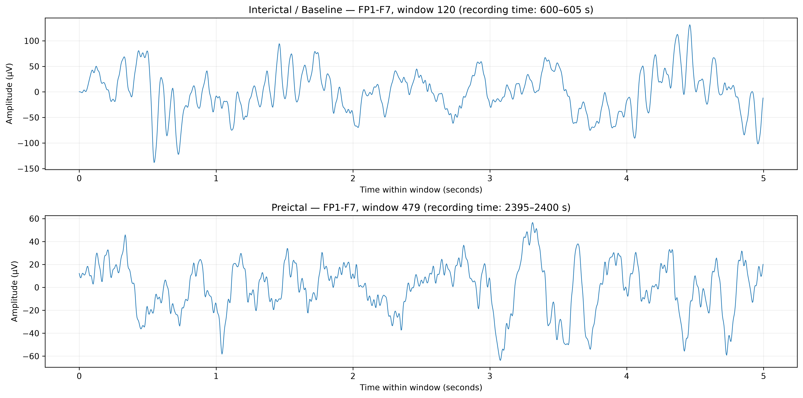
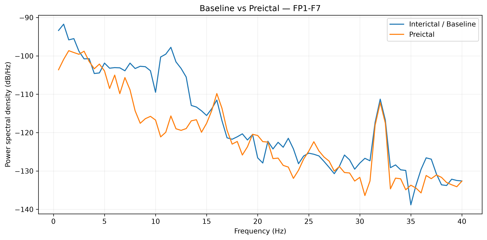

# Visualizing Neural Storms | Epileptic Seizure Analysis


## EEG Dataset Inspection and Preparation 

This repository documents the **initial inspection and understanding of
EEG data** for the capstone project *Epileptic Seizure Prediction Using
Deep Learning*.

The goal of this phase is to understand what an EDF recording contains,
how continuous EEG signals are represented numerically, how they can be
divided into time-framed windows, and how a window can be converted into
a time-frequency representation using the Short-Time Fourier Transform
(STFT).

> **Scope:** This README documents dataset inspection and an initial
> feature-extraction experiment only. It does not claim that a
> seizure-prediction model has been trained, validated, or clinically
> evaluated.

------------------------------------------------------------------------

## Contents

-   [1. Dataset overview](#1-dataset-overview)
-   [2. What is inside an EDF file?](#2-what-is-inside-an-edf-file)
-   [3. Recording inspected](#3-recording-inspected)
-   [4. Understanding the EEG data](#4-understanding-the-eeg-data)
-   [5. Inspection workflow](#5-inspection-workflow)
-   [6. Preprocessing experiment](#6-preprocessing-experiment)
-   [7. Converting continuous EEG into
    windows](#7-converting-continuous-eeg-into-windows)
-   [8. Seizure annotations and provisional
    labels](#8-seizure-annotations-and-provisional-labels)
-   [9. Converting windows into STFT
    spectrograms](#9-converting-windows-into-stft-spectrograms)
-   [10. Visual comparisons](#10-visual-comparisons)
-   [11. Output files and recommended
    structure](#11-output-files-and-recommended-structure)
-   [12. Important limitations](#12-important-limitations)
-   [13. Tools and libraries](#13-tools-and-libraries)
-   [14. References](#14-references)

------------------------------------------------------------------------

## 1. Dataset overview

This project uses the **CHB-MIT Scalp EEG Database**, a publicly
available collection of scalp EEG recordings from pediatric subjects
with intractable seizures. Recordings are distributed as EDF files, with
accompanying summary information that identifies seizure intervals in
relevant recordings.

-   Dataset: [CHB-MIT Scalp EEG Database ---
    PhysioNet](https://physionet.org/content/chbmit/1.0.0/)
-   Subject folder inspected:
    [CHB01](https://physionet.org/content/chbmit/1.0.0/chb01/)
-   Recording inspected: `chb01_03.edf`
-   Annotation reference: the CHB01 summary file distributed with the
    dataset

The dataset is intended for research. It should not be used as a
standalone diagnostic or real-time clinical warning system.

## 2. What is inside an EDF file?

EDF stands for **European Data Format**, a file format used to store
biomedical signals over time.

An EEG EDF recording contains sampled voltage measurements from multiple
channels. Each channel represents a recorded voltage difference between
electrodes. The data are not stored as a picture of a wave: they are
stored as numerical samples. A plotted waveform is a visualization of
those numbers.

A recording generally provides:

-   **Signal samples:** numeric measurements over time for each channel.
-   **Sampling frequency:** how many samples are recorded per second.
-   **Channel labels:** names identifying the electrode pairs or signal
    channels.
-   **Recording duration:** the total time covered by the file.
-   **Metadata:** information such as channel types and acquisition
    details.
-   **Seizure timing information:** typically provided in the dataset's
    accompanying summary/annotation material, rather than inferred from
    the waveform plot alone.

### Sampling frequency example

The inspected file has a sampling rate of **256 Hz**. This means each
channel contains 256 samples per second.

For a five-second window:

`256 samples/second × 5 seconds = 1,280 samples per channel`

With 23 channels, a five-second segment contains `23 × 1,280` values
before any channel is excluded.

## 3. Recording inspected

The following values were printed by MNE-Python when `chb01_03.edf` was
loaded.

  Property                                               Observed value
  ---------------------------------------- ----------------------------
  File                                                   `chb01_03.edf`
  Duration                                   3,600 seconds (60 minutes)
  Sampling frequency                                             256 Hz
  Original channels                                                  23
  Total samples per channel                                     921,600
  Original data array shape                              `(23, 921600)`
  Window duration used in the experiment                      5 seconds
  Samples per window per channel                                  1,280
  Non-overlapping windows                                           720
  Annotated seizure onset                         2,996 seconds (49:56)
  Annotated seizure end                           3,036 seconds (50:36)
  Annotated seizure duration                                 40 seconds

The channel labels reported by MNE were:

``` text
FP1-F7, F7-T7, T7-P7, P7-O1, FP1-F3, F3-C3, C3-P3, P3-O1,
FP2-F4, F4-C4, C4-P4, P4-O2, FP2-F8, F8-T8, T8-P8-0, P8-O2,
FZ-CZ, CZ-PZ, P7-T7, T7-FT9, FT9-FT10, FT10-T8, T8-P8-1
```

### What does `(23, 921600)` mean?

The first dimension represents the 23 channels. The second represents
the 921,600 samples recorded by each channel. With 256 samples per
second, the recording lasts 3,600 seconds.

MNE returns the EEG signal in SI units (volts). For plots and tables
that are easier to read, the values can be multiplied by 1,000,000 to
express them in microvolts (µV).

## 4. Understanding the EEG data

### Continuous waveform

An EEG recording is a continuous sequence of measurements. Each channel
produces its own time series. The waveform plot displays amplitude
against time.

A waveform can help us inspect signal variation, but visual inspection
alone is not enough to reliably identify a pre-seizure state. Signals
can also contain eye movement, muscle activity, electrode artifacts, and
other noise.

### Channel statistics

During inspection, the following statistics were calculated per channel:

-   **Mean:** average amplitude across the recording.
-   **Standard deviation:** how much the signal varies.
-   **Minimum and maximum:** observed extreme amplitudes.

Large extrema or standard deviations can flag sections for closer
inspection, but they do not automatically mean a channel is faulty.
Signal quality should be assessed using plots, metadata, domain
knowledge, and consistent criteria.

### Duplicate-channel finding

The two channels `T8-P8-0` and `T8-P8-1` were compared sample by sample.
In this recording, the measured correlation was `1.0`, and the maximum
absolute difference was `0.0 µV`; their arrays were exactly identical.

For the exploratory working copy, `T8-P8-1` was removed, leaving 22
channels. This is a recording-specific, evidence-based cleaning
decision. The same check must be performed for other EDF files rather
than assuming the duplication exists in every recording.

## 5. Inspection workflow

The initial notebook workflow was:

1.  Load the EDF file using MNE-Python.
2.  Inspect duration, sampling frequency, channel names, and array
    dimensions.
3.  Convert amplitudes from volts to microvolts for readable summaries
    and plots.
4.  Calculate basic channel statistics.
5.  Plot the EEG around the annotated seizure interval.
6.  Compare the original and band-pass-filtered signal.
7.  Compare suspected duplicate channels.
8.  Create five-second windows and preserve their time indices.
9.  inspect the seizure annotations and create provisional labels for
    experimentation.
10. Convert selected windows into STFT magnitude spectrograms.


## 6. Preprocessing experiment

A working copy of the original recording was filtered using a
preliminary band-pass filter from **0.5 Hz to 40 Hz**:


### Why filter EEG?

Filtering can reduce slow baseline drift and frequency components above
the chosen passband. The selected range is an initial experimental
choice, not a universal setting for every seizure-prediction study.

Filtering does **not** automatically remove all artifacts or make the
data ready for training. The effect should be checked by comparing raw
and filtered waveforms, and preprocessing must be applied consistently
across recordings. The original `raw` object was kept unchanged.

## 7. Converting continuous EEG into windows

Deep-learning models generally need examples with consistent shapes.
Instead of treating a one-hour recording as one input, the continuous
signal can be divided into shorter time-framed windows.

For this experiment, the window duration was five seconds, with no
overlap.

### Calculation

-   Sampling frequency: 256 Hz
-   Window duration: 5 seconds
-   Samples per window: `256 × 5 = 1,280`
-   Recording duration: 3,600 seconds
-   Number of non-overlapping windows: `3,600 ÷ 5 = 720`

Before duplicate-channel removal, the window array had this shape:

`(720, 23, 1280)`

After removing one exactly duplicated channel, the working window array
had this shape:

`(720, 22, 1280)`

The dimensions mean:

`(number of windows, number of channels, samples per channel)`


### Why preserve timestamps?

Every window must retain its start and end time so it can be matched to
seizure annotations. Without this information, it is easy to assign the
wrong label to a window.

In later stages, window duration and overlap can be evaluated as
experimental choices. Changing them changes the number of samples per
example and the temporal resolution of the model.

## 8. Seizure annotations and provisional labels

The accompanying CHB01 summary identifies the seizure in `chb01_03.edf`
as starting at 2,996 seconds and ending at 3,036 seconds.

For the first labeling experiment, a **30-minute preictal interval** was
provisionally defined as the 30 minutes immediately before the annotated
seizure onset:

-   Preictal interval start: `2996 − 1800 = 1196` seconds (19:56).
-   Seizure onset: 2,996 seconds (49:56).
-   Seizure end: 3,036 seconds (50:36).

The experimental labels were:

-   `1` --- window entirely inside the chosen preictal interval and
    ending no later than seizure onset.
-   `0` --- provisional baseline candidate outside the preictal and
    seizure intervals.
-   `NaN` --- excluded from this binary experiment, including windows
    overlapping the seizure interval and windows in the excluded
    interval between the preictal period and seizure onset.

The observed provisional distribution was:

  Category                     Window count
  -------------------------- --------------
  Preictal (`1`)                        359
  Baseline candidate (`0`)              351
  Excluded (`NaN`)                       10
  Total                                 720

These are the results of the notebook's current labeling rules. They are
**not evidence that the labels are clinically validated**. In
particular, this one-hour recording does not provide a full 60-minute
baseline before the selected preictal interval, and post-seizure windows
may not be appropriate baseline examples.

The preictal duration is a research parameter that must be justified and
tested. Seizure-prediction studies may define prediction horizon,
seizure occurrence period, and preictal duration differently. The labels
should be revisited before training a final model.

## 9. Converting windows into STFT spectrograms

A five-second waveform contains information about amplitude over time.
The **Short-Time Fourier Transform (STFT)** converts it into a
time-frequency representation, showing how the signal's frequency
content changes over short segments.

### STFT settings used

  Parameter                                                             Value
  ---------------------------------------------- ----------------------------
  Sampling frequency                                                   256 Hz
  Window duration                                                   5 seconds
  `nperseg`                                                       128 samples
  Segment duration                                                0.5 seconds
  `noverlap`                                                       96 samples
  Step between segments                            32 samples (0.125 seconds)
  Frequency resolution                                                   2 Hz
  Frequency range retained for full extraction                       0--40 Hz

The STFT was calculated using `scipy.signal.stft`. The magnitude
`abs(Zxx)` was used as the initial feature representation. For plotting,
magnitude was displayed in decibels using
`20 × log10(magnitude + epsilon)`.


### How to read the spectrogram

-   **X-axis:** time within the five-second window.
-   **Y-axis:** frequency in Hz.
-   **Color:** STFT magnitude, displayed in decibels.

Each spectrogram is a numerical matrix, not merely an image. It can be
passed to a convolutional neural network after the input representation
and normalization strategy have been decided.

### Full feature array

For the 710 provisionally labeled windows, the initial STFT magnitude
array had this shape:

`(710, 22, 21, 41)`

The dimensions mean:

`(examples, channels, frequency bins, time frames)`

The 21 frequency bins correspond to 0--40 Hz at 2 Hz spacing. The 41
time frames result from the selected SciPy STFT boundary and padding
settings. The labels array had shape `(710,)`, with 351 baseline
candidates and 359 preictal examples.

The values in this array are initial STFT magnitudes. They have not yet
undergone a final training-data normalization or validation procedure.

## 10. Visual comparisons

The notebook was used to inspect waveforms, spectrograms, and power
spectral density (PSD) for a selected baseline candidate and a selected
preictal window. If the corresponding PNG files have been saved in
`outputs/plots/`, the following images will appear in the README.

### 10.1 EEG waveform: baseline vs preictal

This plot compares the actual five-second EEG waveform from channel
`FP1-F7` in the two selected windows.



**What it shows:** amplitude versus time for two selected windows. It is
useful for checking signal morphology, but a visual difference between
two windows does not establish a reliable prediction pattern.

### 10.2 STFT spectrogram: baseline vs preictal

This plot compares the time-frequency representation of the same
selected windows.


**What it shows:** how the measured signal's frequency content changes
during each five-second segment. These matrices are a candidate input
representation for the CNN stage.

### 10.3 Power spectral density: baseline vs preictal

This plot compares the estimated power spectral density of the selected
windows using Welch's method.



**What it shows:** how estimated signal power is distributed across
frequencies. PSD summarizes frequency content over the selected window,
while an STFT spectrogram retains information about changes across time.

> **Important:** these figures are exploratory comparisons of two
> selected windows. They should not be interpreted as general
> differences between all preictal and interictal EEG, and they do not
> demonstrate model performance. If a PNG has not yet been generated,
> save the corresponding notebook figure to the indicated path or update
> the path in this section.

## 11. Output files and recommended structure

A suggested project layout is:

``` text
epileptic-seizure-prediction/
├── data/
│   ├── raw/
│   │   ├── chb01_03.edf
│   │   └── chb01-summary.txt
│   └── processed/
├── notebooks/
│   └── 01_dataset_inspection.ipynb
├── outputs/
│   ├── plots/
│   │   ├── eeg_baseline_vs_preictal.png
│   │   ├── stft_baseline_vs_preictal.png
│   │   └── psd_baseline_vs_preictal.png
│   ├── features/
│   └── metrics/
├── models/
├── src/
└── requirements.txt
```

Recommended output conventions:

-   `outputs/plots/`: figures generated by notebooks.
-   `outputs/features/`: saved STFT arrays and corresponding labels once
    the format is finalized.
-   `outputs/metrics/`: evaluation results and charts when model
    evaluation begins.
-   `data/processed/`: cleaned or transformed data that can be
    reproduced from the original recordings.
-   `models/`: model checkpoints after training begins.

The folder tree is a recommendation; only the files that have actually
been created in your local project should be considered present. Keep
the original EDF file unchanged. Consider adding large EDF files and
generated arrays to `.gitignore` rather than committing them to Git.

## 12. Important limitations

This phase is about understanding and preparing data, not building a
validated predictor.

1.  **One recording is not enough.** The current recording contains one
    annotated seizure. Reliable evaluation requires more recordings and
    seizure events.
2.  **Provisional labels need review.** The selected 30-minute preictal
    period is an experimental definition, not a proven physiological
    boundary.
3.  **Baseline selection matters.** Post-seizure data may differ from
    stable interictal data. A suitable baseline strategy must be defined
    before training.
4.  **Avoid data leakage.** Do not randomly split highly correlated
    adjacent windows from the same recording across training and test
    sets. Use recording-wise or subject-wise evaluation where
    appropriate, with a clear plan for unseen seizures and subjects.
5.  **Preprocessing must be consistent.** Channel selection, filtering,
    scaling, windowing, and STFT settings should be applied consistently
    across recordings.
6.  **A spectrogram is not a prediction.** The CNN-LSTM model, once
    developed, must be trained and evaluated on appropriate data.
    Sensitivity, false prediction rate, prediction horizon, and other
    metrics must be defined and reported honestly.
7.  **Research prototype only.** This capstone pipeline is not a medical
    device and must not be used to make clinical decisions or replace
    professional care.

## 13. Tools and libraries

  Tool / library     Purpose
  ------------------ --------------------------------------------
  Python             Data processing and experimentation
  MNE-Python         Read EDF files and inspect EEG recordings
  NumPy              Numerical arrays and window reshaping
  Pandas             Channel statistics, timestamps, and labels
  Matplotlib         Waveform and spectrogram plots
  SciPy              STFT and Welch PSD calculations
  Jupyter Notebook   Step-by-step, reproducible exploration

Install the dependencies with:

``` bash
python -m pip install mne numpy pandas matplotlib scipy jupyter
```

## 14. References

1.  Shoeb, A. H. (2009). *Application of Machine Learning to Epileptic
    Seizure Onset Detection and Treatment*. PhD thesis, Massachusetts
    Institute of Technology. The CHB-MIT database is available through
    PhysioNet.
2.  CHB-MIT Scalp EEG Database, PhysioNet:
    https://physionet.org/content/chbmit/1.0.0/
3.  CHB01 subject recordings and summary, PhysioNet:
    https://physionet.org/content/chbmit/1.0.0/chb01/
4.  MNE-Python EDF reader documentation:
    https://mne.tools/stable/generated/mne.io.read_raw_edf.html
5.  SciPy STFT documentation:
    https://docs.scipy.org/doc/scipy/reference/generated/scipy.signal.stft.html
6.  SciPy Welch PSD documentation:
    https://docs.scipy.org/doc/scipy/reference/generated/scipy.signal.welch.html

------------------------------------------------------------------------

**Current status:** Phase 1 --- dataset inspection, basic signal-quality
checks, preliminary filtering, five-second windowing, provisional
seizure-window labels, and exploratory STFT extraction.

**Next phase (not yet completed):** review the labeling protocol,
inspect more recordings, establish a consistent preprocessing pipeline,
and only then design and evaluate CNN-LSTM training.
